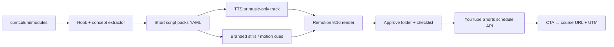

# Faceless YouTube Shorts studio — design spec

**Date:** 2026-08-11  
**Status:** Draft for user review  
**Product:** LLM Leverage Course (https://llm-leverage-course.vercel.app)

## Problem

The course has a full 12-module curriculum (`curriculum/`) and a live app, but no scalable distribution channel. We want a **faceless YouTube Shorts** channel that grows brand awareness and drives enrollments/visits to the course, with near-full automation for weekly batch production (scripts, kinetic-text video, AI voice or music-only, schedule) and a mandatory human QA gate.

## Goals

1. Turn curriculum concepts into Shorts without rewriting the syllabus (curriculum remains source of truth).
2. Ship a **weekly batch** of Shorts (default 7), schedule them across the week.
3. Default visual: **kinetic text + simple motion graphics** on branded backgrounds (Remotion).
4. Audio mix: **AI voiceover + captions** for most Shorts; **music + captions** for variety (~20%).
5. Every Short CTAs to the course with UTM tracking.
6. Stay clear of YouTube “inauthentic / repetitious” risk via original curriculum hooks, varied formats, and human approval before publish.

## Non-goals (v1)

- On-camera face, avatar talking-head, or full AI video b-roll as the default look
- Long-form YouTube videos
- Auto-post to TikTok / Instagram Reels (export reuse later is fine)
- Live analytics product or paid ads
- Monetization optimization as the primary success metric

## Decisions locked

| Topic | Choice |
|-------|--------|
| Channel job | Brand growth + course as primary CTA |
| Automation | Near-full (batch generate + schedule); human QA required |
| Audio | Mix: AI voice default; music-caption variants |
| Cadence | Weekly batch, then schedule out |
| Visual | Kinetic text + motion graphics on branded backgrounds |
| Approach | Curriculum-to-Shorts studio **in this repo** |

## Architecture



### Units

| Unit | Responsibility |
|------|----------------|
| `extractor` | Pull one idea / hook / CTA from a module step |
| `script-writer` | Produce 30–55s Short script (`voice` or `music_caption`) |
| `asset-gen` | Branded backgrounds + title cards (image API, cached) |
| `renderer` | Remotion compositions: kinetic text + motion |
| `batcher` | Weekly run → `content-studio/out/batch-YYYY-MM-DD/` |
| `publisher` | Upload + schedule only after `approve: true` |
| `analytics` (later) | Map Short id → module → course visits |

## Content model

### Script pack schema

Stored under `content-studio/scripts/*.yaml` (and copied into each batch folder).

```yaml
id: mental-model-desk-space-01
module: 01-mental-model
anchor: "Context window = desk space"
format: voice   # voice | music_caption
hook: "Your AI isn't dumb — your desk is crowded."
beats:
  - text: "Think of the context window as desk space."
    visual: title_card
  - text: "Too many sticky notes → worse answers."
    visual: kinetic_list
  - text: "Clear the desk. Keep the goal and the facts."
    visual: punchline
cta: "Free LLM Leverage course — link in bio"
duration_target_sec: 45
tags: [context-window, beginners]
```

Rules:

- Every Short has a **curriculum anchor** (module slug + concept). No invented syllabus.
- Duration target: **30–55 seconds**.
- CTA required on every Short.
- Description must include course URL with UTM:  
  `?utm_source=youtube&utm_medium=shorts&utm_campaign=<id>`

### Formats

| Format | Audio | On-screen | Share of batch |
|--------|-------|-----------|----------------|
| `voice` | AI TTS | Captions + kinetic emphasis | ~80% |
| `music_caption` | Cleared bed music | Larger kinetic text | ~20% |

### Series lanes

1. **One idea** — single module concept (default).
2. **Myth vs fix** — common mistake → course habit.
3. **Loop moment** — one node of the context-loop diagram.

### Weekly batch

- Default **7 Shorts** (one scheduled per day).
- Mix ~5–6 `voice` + 1–2 `music_caption`.
- Spread across modules; do not exhaust Module 1 in week one.

## Production stack

| Layer | Choice |
|-------|--------|
| Scripts | LLM (prefer Vercel AI Gateway-style `provider/model` strings) |
| TTS | ElevenLabs or Gateway-equivalent voice API |
| Music | Cleared beds in `content-studio/audio/beds/` |
| Stills | Image gen via branded prompt pack → cached PNGs |
| Render | Remotion, 1080×1920 |
| Batch | `npm run shorts:batch` |
| Publish | YouTube Data API upload + `publishAt` |
| Secrets | Env vars (keys from Obsidian/vault flow); never commit |

### Remotion templates (v1 only)

1. `TitlePunch` — hook → 2–4 beats → CTA  
2. `ListReveal` — numbered myth/fix or steps  
3. `LoopSnippet` — one context-loop node highlighted  

### Brand

- Align with existing course marketing: slate/teal, Fraunces + Source Sans.
- Working channel name: **LLM Leverage**.
- End card: course name as hero signal + short CTA (not a secondary eyebrow).

## QA gate

Batch output layout:

```
content-studio/out/batch-YYYY-MM-DD/
  scripts/
  audio/
  frames/
  renders/
  errors.json
  APPROVAL.md
```

`APPROVAL.md` (or sibling `approval.yaml`) must set `approve: true` for IDs the publisher may upload. Publisher **refuses** unapproved IDs.

Checklist before approve:

- [ ] Factual vs curriculum anchor  
- [ ] No overclaim (legal/medical/guaranteed income)  
- [ ] CTA present and link correct  
- [ ] Captions readable on mobile  
- [ ] Not a near-duplicate of last week  
- [ ] Description includes course URL + UTM (and AI disclosure if channel policy requires it)

### Error handling

Failed TTS, image, or render: skip that Short, append to `errors.json`, continue batch. Partial batches are valid.

## Repo layout

```
content-studio/
  brand/
  prompts/
  compositions/    # Remotion
  scripts/         # durable YAML packs
  audio/beds/
  out/             # gitignored
  src/             # CLI: extract, write, tts, render, publish
```

App learner routes stay unchanged. Studio is a sibling package/workspace under this repo, not a rewrite of `src/app`.

## Weekly ops (< ~2 hours human)

1. Run batch (`shorts:batch`).
2. Review renders + fill approval.
3. Run publish (`shorts:publish`) to schedule the week.
4. Pin comment / confirm description link.
5. Weekly glance at retention; retire weak formats.

## Phased delivery

| Phase | Deliverable | Exit criteria |
|-------|-------------|-----------------|
| **P0** | Schema, extractor, script writer, `TitlePunch`, local render | One golden Module-1 Short mp4 in `out/` |
| **P1** | TTS + music_caption, all 3 templates, batch of 7 | Full batch folder + APPROVAL.md |
| **P2** | YouTube OAuth upload/schedule + UTM descriptions | Week scheduled from CLI |
| **P3** | Light Short→module analytics, prompt tuning | CSV or simple report enough |

## Testing (TDD)

- Unit tests: script schema validation, caption length / timing estimates, Remotion prop builders.
- Fixtures: Module 1 golden script packs.
- Dry-run publish mode (no YouTube API call).
- Content quality: reject scripts missing `module`, `anchor`, `cta`, or empty `beats`.

## Success metrics (v1)

- Batches complete and schedule on cadence.
- Clicks/visits to course from Shorts UTMs.
- Watch percentage healthy on teaching Shorts (target guidance: ~50%+; tune after first weeks).
- No policy strikes / inauthentic-content flags.

## Risks & mitigations

| Risk | Mitigation |
|------|------------|
| YouTube inauthentic-content policy | Curriculum-grounded hooks, format variety, human QA, avoid mass identical templates |
| Voice/API cost | Cache audio by script hash; reuse beds; cap weekly batch size |
| Brand drift | Fixed Remotion templates + brand tokens; no freeform layouts in v1 |
| Curriculum drift | Extractor reads `curriculum/` at batch time; scripts store module + anchor |

## Open items (explicit, deferred)

- Final channel handle / display name (default LLM Leverage until chosen).
- Exact TTS voice ID and music bed licenses (configure at P1).
- Whether descriptions include an AI-assisted disclosure line (channel policy choice at P2).
